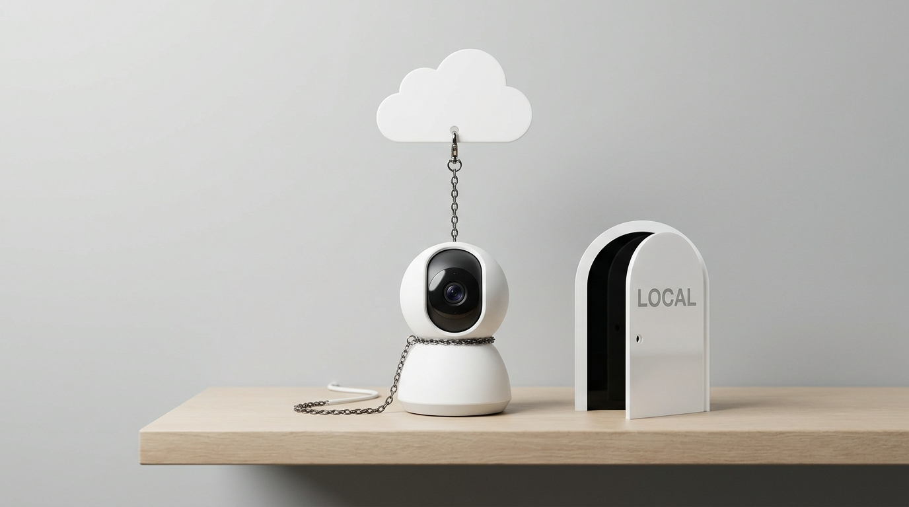
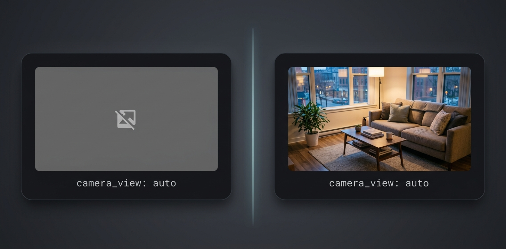

# Aqara Camera HomeKit Snapshot Fix for Home Assistant



Fixes the **broken / grey camera image** you get in Home Assistant with HomeKit cameras (Aqara Camera E1 and others) when a dashboard card uses `camera_view: auto`, or when you call the `camera.snapshot` action.

No new entities, no stream, no go2rtc, no configuration. One line in `configuration.yaml`, restart, done.

**Works with:** `picture-entity`, `picture-glance`, `picture-elements` cards, `camera.snapshot`, notifications with camera images, the Companion app, Firefox / Chrome / Safari.

## Install

### HACS (recommended)

1. HACS → ⋮ (top right) → **Custom repositories**
2. Repository: `https://github.com/domotick/aqara-camera-homekit-snapshot-fix` — Type: **Integration** → Add
3. Search **HomeKit Snapshot Fix** → Download

### Manual

Copy `custom_components/homekit_snapshot_fix` into your `config/custom_components/` folder.

### Enable

Add this line to `configuration.yaml`, then restart Home Assistant:

```yaml
homekit_snapshot_fix:
```

Check **Settings → System → Logs**: you should see
`HomeKit camera snapshots now use advertised sizes`.

Your existing cards need no change. Example:

```yaml
type: picture-entity
entity: camera.living_room_camera
camera_image: camera.living_room_camera
camera_view: auto
```

### Uninstall

Remove the line from `configuration.yaml`, restart. Nothing is left behind.

## Affected cameras

Any camera paired to Home Assistant through the **HomeKit Device** integration (`homekit_controller`) that only answers snapshot requests at the sizes it advertises.

| Camera | Status |
|---|---|
| Aqara Camera E1 (CH-C01E) | **Confirmed** — this is where the fix was built and tested |
| Aqara Camera Hub G2H / G2H Pro, G3, Doorbell G4 / G410 | Very likely (same firmware family, same HomeKit stack) — reports welcome |
| Other HomeKit Secure Video cameras (Eve, Logitech Circle, Netatmo, Eufy, Anker…) | Possibly, if snapshots time out at odd card sizes — reports welcome |

If it fixes your camera, please open an issue with the model so the table can grow.

## Symptoms this fixes



- `camera_view: auto` shows a **broken image icon** on a grey background, while `camera_view: live` works.
- The image appears after ~10 seconds, or never.
- `camera.snapshot` produces an empty or missing file.
- Camera thumbnails in notifications are missing.
- Same behaviour in every browser and in the Companion app.

## Why it happens (the long version)

A dashboard card asks Home Assistant for a snapshot **at the card's own pixel size**, for example `/api/camera_proxy/camera.x?width=996&height=561`. The HomeKit Device integration passes that size straight to the camera:

```python
return await self._accessory.pairing.image(self._aid, width or 640, height or 480)
```

In the HomeKit protocol the requested size is only a hint. Many cameras serve the few sizes they advertise in their *Supported Video Stream Configuration* (640×480, 1280×720, 1920×1080…) and ignore anything else. Aqara's firmware goes one step further: for a size it doesn't know, it **never answers**. Home Assistant waits 10 seconds, gives up, and the card shows a broken image.

`camera_view: live` works because the MJPEG path calls the camera **without a size**, so the camera returns its default picture.

### What this integration does

It replaces `HomeKitCamera.async_camera_image` in memory with a version that:

1. reads the sizes the camera advertises (decoded live from `aiohomekit`, or parsed from the base64 TLV cached on disk);
2. picks the **smallest advertised size, in the camera's own aspect ratio, that covers what the card asked for** (996×561 → 1280×720; 498×280 → 640×360; no size → widest up to 1280 px);
3. asks the camera for that size and lets Home Assistant scale the result down, as it already does for every camera.

If the camera advertises nothing, or still doesn't answer, it falls back to the original behaviour — so it is never worse than before.

### Limitations

- It patches a class of the built-in `homekit_controller` integration at runtime. A future Home Assistant release could change that class and silently disable the fix (you'd be back to the original behaviour, not broken).
- It only touches snapshots. For a real live video stream (H.264, audio) from a HomeKit camera, see [radiantnode/homekit-camera-live](https://github.com/radiantnode/homekit-camera-live), which bundles the same size logic together with a private go2rtc.
- The right place for this fix is Home Assistant core itself. If you can help land it there, please do.

## Related

- [home-assistant/core #134418](https://github.com/home-assistant/core/issues/134418) — Poor performance of Aqara camera E1 with HomeKit
- [Aqara forum — RTSP Stream Camera E1](https://forum.aqara.com/t/rtsp-stream-camera-e1/175837) (the E1 has no RTSP; HomeKit is the only local path)
- [radiantnode/homekit-camera-live](https://github.com/radiantnode/homekit-camera-live) — the project `sizes.py` comes from

## Credits & license

Size selection logic adapted from [radiantnode/homekit-camera-live](https://github.com/radiantnode/homekit-camera-live) by Michael Simmons (MIT). This project is MIT licensed as well — see `LICENSE`.

---

*Keywords: Home Assistant, HomeKit Controller, HomeKit Device, homekit_controller, Aqara Camera E1, Aqara G2H Pro, Aqara G3, Aqara G4, HomeKit Secure Video, HKSV, camera snapshot, broken image, grey image, camera_view auto, picture-entity, picture-glance, camera_proxy, timeout, 10 seconds, HACS custom integration.*
